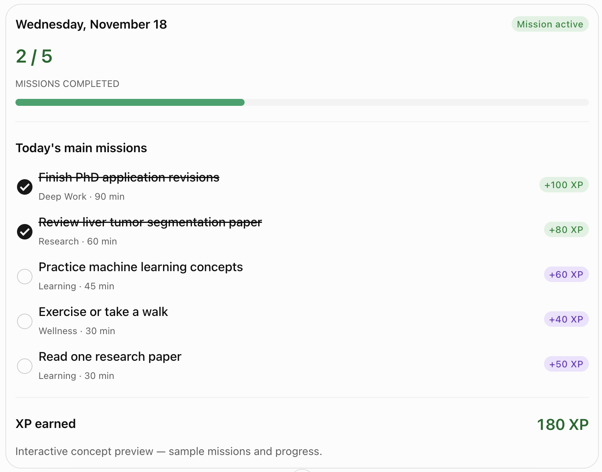

# DAYQUEST

**A smart productivity system × gamification × AI personal coach.**

DAYQUEST turns your daily to-do list into a quest. You plan the day's **missions** the night before or that morning, check in with your energy and focus, and work through missions with a **Pomodoro focus timer**. Finished work earns **XP**, which levels up an **original companion creature** that grows with you. An **AI coach** helps you plan a realistic day and get started. It never decides your rewards.



> **Status:** Phase 0 (foundation). The XP, leveling and capacity engine is built and tested, and a Today page prototype runs on sample data. The full spec is in **[docs/DESIGN.md](docs/DESIGN.md)**.

## Getting started

Requires **Node 22.12+** (the repo pins Node 24 in `.nvmrc`), **pnpm**, and **Docker Desktop** (running) for the local database.

```bash
nvm use                      # picks up .nvmrc
pnpm install
pnpm db:start                # local Supabase in Docker (first run downloads ~2 GB of images)
cp .env.example .env.local   # then paste the keys printed by `pnpm supabase status`
pnpm dev                     # http://localhost:3000
```

Local Supabase runs entirely in Docker: API at `http://127.0.0.1:54321`, Studio (table browser) at `http://127.0.0.1:54323`, and a test inbox for sign-in emails at `http://127.0.0.1:54324`. Realtime, storage, analytics and edge functions are turned off in [supabase/config.toml](supabase/config.toml) to save resources.

| Command | What it does |
| --- | --- |
| `pnpm dev` | Start the dev server |
| `pnpm test` | Run unit tests (engine, formatting, theme contrast) |
| `pnpm typecheck` | Generate Next.js route types, then type-check |
| `pnpm lint` | ESLint |
| `pnpm build` | Production build |
| `pnpm db:start` / `pnpm db:stop` | Start / stop local Supabase (data is kept between runs) |
| `pnpm db:reset` | Recreate the local database from `supabase/migrations` (**wipes local data**) |
| `pnpm db:test` | Run database tests (RLS and XP integrity, in `supabase/tests`) |
| `pnpm db:types` | Regenerate TypeScript types from the local schema |

---

## Core ideas

| | |
| --- | --- |
| 🎯 **Daily missions** | Each task has an importance, a difficulty and an estimated duration. The app warns you before you overload your day. |
| 🔋 **Morning check-in** | Four quick inputs (energy, focus, mood, available time) produce a realistic recommended workload. You can re-check in mid-day if your energy changes. |
| ⏱️ **Focus mode** | 25/5 or 50/10 Pomodoro sessions tied to one mission, with ambient sound. Measured focus time earns XP. |
| ⚔️ **Boss Battles** | Big tasks become bosses. Each finished subtask lowers the boss's health. |
| 🐣 **Companion** | One original creature that hatches, grows and evolves as you level up. It's always encouraging and never guilt-tripping. |
| 🤖 **AI coach** | Morning planning, "what's next?", smaller first steps when you're stuck, evening reflection, weekly report. |
| 📈 **Growth** | Focus hours, completion rate, energy patterns, and forgiving consistency metrics ("showed up 5 of 7 days"). |

## Design principles

1. **Encourage, never punish.** A missed day costs nothing.
2. **Reward effort, not checkboxes.** Measured focus time counts.
3. **Energy changes the plan, not the reward.**
4. **The AI advises; a deterministic engine awards XP.** Every XP change is an auditable transaction.

## How the numbers work (summary)

- **Task XP** = 20 × difficulty (1.0–2.0) × importance (0.8–1.3) × completion (0.5–1.0), halved for quick tasks under 15 min. On top of that come **focus XP** (+10 per 25-min session) and capped daily bonuses.
- **Leveling:** XP to the next level = 100 + 25(L−1) + 3(L−1)². A regular user reaches level 15 in about a month and level 30 in about five months.
- **Capacity** = min(T, T × energy × focus), and the recommended workload is 80 % of that.

The formulas, tables and examples are in [DESIGN.md §5–7](docs/DESIGN.md#5-xp-engine).

## Themes

You choose a base theme, and **variants** (accent colors, timer skins, sound packs, backgrounds) unlock as you level up. Themes are built one at a time:

1. **Minimal** (light, clean). Ships in v1.
2. **Mission Control** (dark neon).
3. **Cozy** (warm pastel).

## Planned stack

Next.js (App Router) · React · TypeScript · Tailwind CSS · Framer Motion · Zustand · PostgreSQL · Rive (companion) · Lottie (celebrations) · Claude API (coach) · Supabase Auth. The XP, leveling and capacity engines are a separate, pure TypeScript module with unit tests.

## Roadmap

| Phase | Focus |
| --- | --- |
| 0 · Foundation | Repo, design tokens + Minimal theme, tested engine package |
| 1 · Core engine | Missions, check-in and capacity, focus timer, XP and levels, evening carry-over |
| 2 · Game experience | Rive companion, celebrations, achievements, unlockable variants |
| 3 · Intelligence | AI coach, task breakdown, Boss Battles |
| 4 · Personalization | Growth dashboard, weekly report, calendar sync, more themes |

## Repository layout

```text
src/
  engine/        Pure TypeScript game engine (XP, leveling, capacity, day rollover) + tests
  theme/         Theme checks (WCAG AA contrast test)
  components/    UI primitives and the Today view
  lib/           Formatting helpers and Phase 0 sample data
  app/           Next.js App Router (layout, Today page, theme tokens in globals.css)
docs/
  DESIGN.md      Full design document
  images/        Concept mockups and reference images
LICENSE          Apache 2.0
```

## License

[Apache 2.0](LICENSE). Reference images in `docs/images/` marked as **external** in the design doc's appendix belong to their original owners and are not covered by this license.
