# DAYQUEST — Design Document

**Status:** Draft v0.2 · design phase, no code yet
**Last updated:** 2026-11-18

DAYQUEST is a personal productivity companion that makes finishing your daily goals feel like playing a game. You plan **missions** for the day (the night before, or that morning), work through them with a **Pomodoro focus timer**, earn **XP**, and raise an **evolving companion creature**. An **AI coach** helps you plan realistically and get started. It never decides your rewards.

**Decision status labels used below**

| Label | Meaning |
| --- | --- |
| ✅ **Decided** | Agreed; build to this. |
| 🟡 **Proposed** | Recommended default; build to this unless changed. |

---

## Contents

1. [Product principles](#1-product-principles)
2. [App structure](#2-app-structure)
3. [Daily experience loop](#3-daily-experience-loop)
4. [Missions (tasks)](#4-missions-tasks)
5. [XP engine](#5-xp-engine)
6. [Leveling](#6-leveling)
7. [Morning check-in & capacity engine](#7-morning-check-in--capacity-engine)
8. [Focus mode & Boss Battles](#8-focus-mode--boss-battles)
9. [AI coach](#9-ai-coach)
10. [Companion system](#10-companion-system)
11. [Themes & visual design](#11-themes--visual-design)
12. [Growth & analytics](#12-growth--analytics)
13. [Technical architecture](#13-technical-architecture)
14. [Data model](#14-data-model)
15. [Roadmap](#15-roadmap)
16. [Appendix: reference images](#appendix-reference-images)

---

## 1. Product principles

1. **Encourage, never punish.** Missing a day costs nothing. The companion never looks disappointed, and no streak "breaks" with a penalty.
2. **Reward effort, not just checkboxes.** Two hours on a hard problem must out-earn five trivial tasks.
3. **Energy changes the plan, not the reward.** A low-energy day gets a lighter recommended workload. Finished work earns the same XP whatever your energy.
4. **The AI advises; the engine decides.** XP, levels, task completion and achievements are deterministic backend operations. The LLM never awards or edits progress.
5. **Make starting easy.** Pick one task, use one timer, and the coach offers a smaller first step when you're stuck.
6. **Every reward is auditable.** Every XP change is a logged transaction with a reason.

---

## 2. App structure

Five main areas:

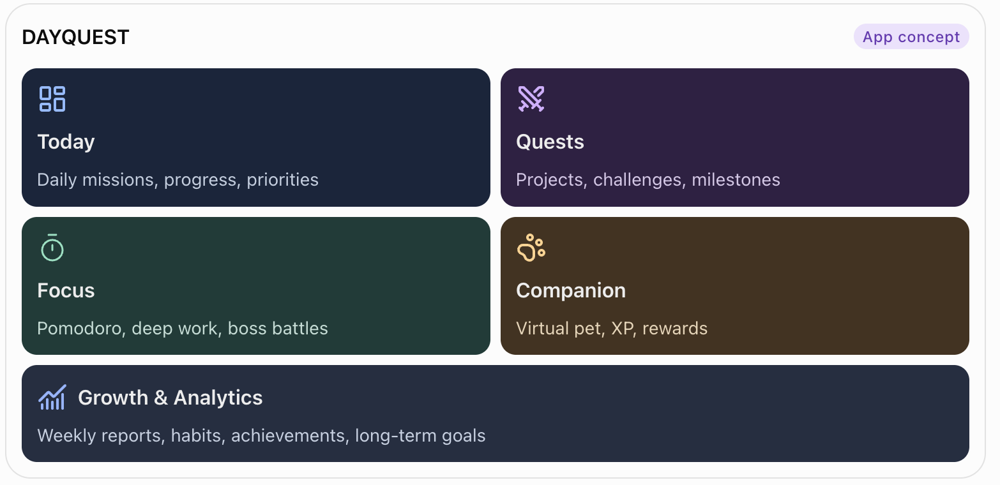

| Area | Purpose |
| --- | --- |
| **Today** | Morning check-in, daily missions, progress, capacity, coach suggestion |
| **Quests** | Multi-day projects, milestones, Boss Battles |
| **Focus** | Pomodoro timer, one-task interface, ambient sound |
| **Companion** | The creature, level, evolution, unlocked variants and achievements |
| **Growth** | Weekly report, focus hours, consistency, energy patterns, long-term goals |

---

## 3. Daily experience loop

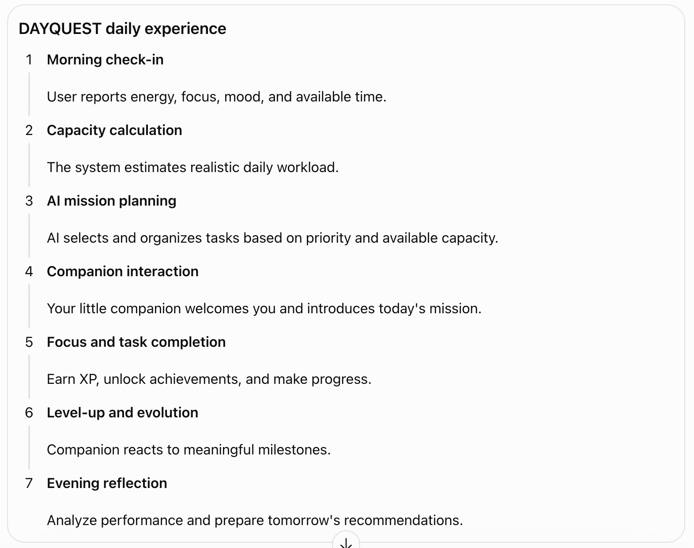

1. **Plan ahead (optional).** The evening before, add tomorrow's missions in a **Tomorrow** view.
2. **Morning check-in** (under 45 s): energy, focus, mood, available time.
3. **Capacity calculation:** the system estimates a realistic workload.
4. **AI mission planning:** the coach orders missions by priority and capacity, and flags overload.
5. **Companion greeting:** the companion introduces today's mission.
6. **Focus and completion:** focus sessions and completed missions earn XP.
7. **Level-up and evolution:** the companion reacts to milestones.
8. **Evening reflection:** summary, gentle carry-over of unfinished missions, and a suggested plan for tomorrow.

**Day boundary** ✅:

- A "day" runs in the user's local time zone and ends at the **rollover hour**: default **04:00**, adjustable from 00:00 to 06:00 in Settings.
- Late-night work therefore counts toward the evening it belongs to.
- The evening reflection prompt appears from **20:00**.
- ✅ The boundary is the local clock hour, so it stays at the rollover hour on daylight-saving days.
- ✅ The time zone and rollover hour are set in **Settings** and can change **once every 24 hours**, because they decide which day XP and bonuses land on. First sign-in sets the time zone from the browser.

---

## 4. Missions (tasks)

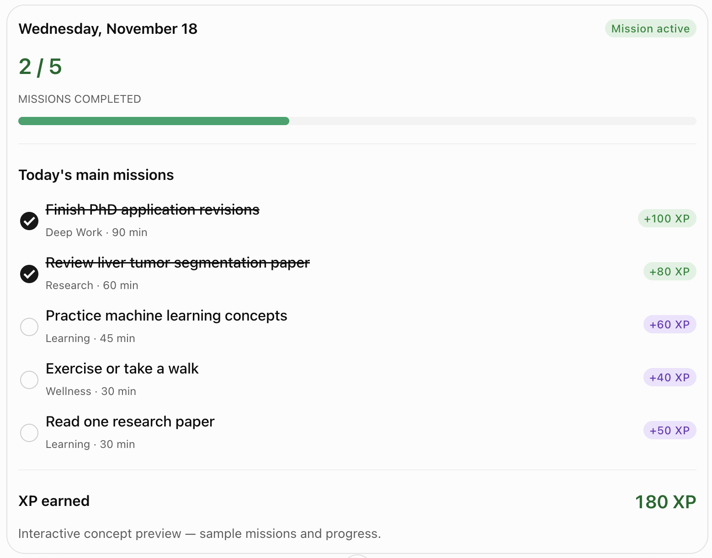

> ⚠️ This mockup uses XP values from an earlier draft (+100, +80, …). Under the engine in §5 those missions earn about 150 XP in total. The card also needs to show **importance** and **difficulty**.

### Attributes ✅

| Attribute | Values |
| --- | --- |
| Title | free text |
| Category | Deep Work, Research, Learning, Writing, Admin, Wellness, … (feeds analytics) |
| Importance | Optional · Normal · Important · Critical |
| Difficulty | Easy · Medium · Hard |
| Estimated duration | 15 · 30 · 60 · 90 min (or custom) |
| Planned date | today or tomorrow |
| Parent | optional; set when the task is a subtask of a Boss or Quest |

### States 🟡

`planned → active → done`, plus `partial`, `carried_over`, `dropped`.

- **Carry-over** happens in the evening reflection. The user chooses which unfinished missions move to tomorrow. Nothing piles up silently.
  - ✅ A carried mission is **copied** to the next day (linked by `carried_from`, shown with a "Carried over" chip). The original stays on its day as `carried_over`, hidden from the list but kept for history.
  - ✅ Optional missions start unticked; the rest start ticked. Unticked missions stay on their day.
  - ✅ Carrying away an unfinished Critical mission doesn't earn "all critical done": it still counts as planned on its day.
  - ✅ **"Move to tomorrow"** on one of today's unfinished missions is a carry-over too, so moving a Critical mission away can't earn the bonus either. Moving the copy back to today undoes the carry.
  - ✅ A mission can't be moved or deleted while a focus session is running on it.
  - ✅ The reflection and the carry-over are written in one server-side transaction, once per day, so a double submit can't carry twice.
  - ✅ **Missed evening:** if a day ended without a reflection and left unfinished missions, the next day's Today page shows "Yesterday's loose ends" to carry them into today. Doing that still earns that day's +10.
  - ✅ The reflection is open from 20:00 until the rollover hour; the server enforces the window. Notes are optional.
- **Un-checking** a completed mission reverses its XP with a compensating transaction (§5.5).

---

## 5. XP engine

All XP comes from a deterministic engine and is recorded in `xp_transactions`.

### 5.1 Task XP ✅

$$XP_{task} = B \times D \times I \times C \times Q$$

| Variable | Meaning | Values |
| --- | --- | --- |
| B | Base reward | 20 |
| D | Difficulty | Easy 1.0 · Medium 1.5 · Hard 2.0 |
| I | Importance | Optional 0.8 · Normal 1.0 · Important 1.15 · Critical 1.3 |
| C | Completion quality | Completed 1.0 · Partial 0.5 · Abandoned 0 (no transaction) |
| Q | Quick-task modifier | 0.5 if estimated duration < 15 min, otherwise 1.0 |

- A full-size task earns **16** (easy and optional) to **52** (hard and critical) XP. Results are rounded to the nearest integer.
- **Why Q exists:** it stops small-task farming. Five 5-minute tasks earn 50 XP instead of 100. Q can only *lower* XP, so mislabeling a task never gains anything.

### 5.2 Focus XP ✅

Duration is **not** a term in the task formula, because estimates are self-reported and easy to inflate. Effort is rewarded through **measured focus time** instead:

| Event | XP |
| --- | --- |
| Completed 25-min focus session | +10 |
| Completed 50-min focus session | +20 |
| Session ended early (≥ 50 % elapsed) | +5 |

- **Daily cap:** 120 focus XP (≈ 6 h of focus).
- Only sessions **linked to a mission** earn focus XP.
- ✅ A session belongs to the day it **started**, both for its XP and for the "2 focus sessions" bonus. Moving its mission to another day afterwards doesn't move the session.
- ✅ Sessions under 10 minutes earn no focus XP and don't count toward the "2 focus sessions" bonus.
- **Custom-length sessions** earn XP proportionally (10 XP per 25 min), and only if they're **at least 10 minutes** long.
- A session counts only if its server-recorded start/end span covers the required time (§8).

**Check against principle 2:** a 2-hour hard, critical task worked in four 25-minute sessions earns 52 + 4 × 10 = **92 XP**. Five 5-minute tasks earn **50 XP**.

### 5.3 Bonus XP ✅ (amounts) / 🟡 (rules)

| Achievement | Bonus | Limit |
| --- | --- | --- |
| Complete all Critical missions | +30 | once per day, requires ≥ 1 critical mission |
| Reach daily XP target | +20 | once per day |
| Complete 2 focus sessions | +15 | once per day |
| Finish a difficult project milestone | +50 | once per milestone |
| Complete evening reflection | +10 | once per day |

**Daily XP target** 🟡 = recommended workload minutes (§7.2) × 1 XP/min, rounded to the nearest 10. Example: 163 min → **160 XP**. A low-energy day therefore has a lower, still reachable target, which follows principle 3: energy changes the plan, not the reward.

### 5.4 Typical day (sanity check)

| Source | XP |
| --- | --- |
| 5 missions (hard/critical, medium/important, medium/normal, easy/optional, easy/normal) | ≈ 152 |
| 6 focus sessions × 10 | 60 |
| Bonuses (critical, target, 2 sessions, reflection) | 75 |
| **Total** | **≈ 290** |

Pacing calculations in §6 assume **~250 XP per active day**.

### 5.5 Integrity rules ✅

- Every award, reversal and adjustment is a row in `xp_transactions` with `source_type`, `source_id` and `reason`.
- A unique key on `(user_id, source_type, source_id, reason)` makes duplicate claims impossible.
- Reversals are new negative rows, never edits or deletes.
- Level, evolution stage and unlocks are **derived** from the XP sum and never stored as separate truth.

---

## 6. Leveling

### 6.1 Curve ✅

The original linear-growth curve, `100 + 25(L−1)`, reaches level 30 in about **52 days**, which is too fast for a final companion evolution. The adopted curve adds a squared term:

$$XP_{next}(L) = 100 + 25(L-1) + 3(L-1)^2$$

$$XP_{total}(L) = 100n + 12.5\,n(n-1) + 0.5\,n(n-1)(2n-1), \quad n = L-1$$

| Level | XP to next | Total XP to reach | ≈ Days at 250 XP/day |
| --- | --- | --- | --- |
| 1 | 100 | 0 | 0 |
| 2 | 128 | 100 | < 1 |
| 3 | 162 | 228 | 1 |
| 5 | 248 | 592 | 2.4 |
| 10 | 568 | 2,412 | 10 |
| 15 | 1,038 | 6,132 | 25 |
| 20 | 1,658 | 12,502 | 50 |
| 30 | 3,348 | 36,192 | 145 |

Early levels come quickly to hook new users; later levels feel earned.

### 6.2 Evolution stages ✅

| Stage | Level | ≈ Time | Theme |
| --- | --- | --- | --- |
| 1 · Hatchling | 1 | day 1 | "Just starting your journey." |
| 2 · Young | 5 | day 2–3 | "Growing with your achievements." |
| 3 · Guardian | 15 | ~1 month | "A symbol of consistency." |
| 4 · Legendary | 30 | ~5 months | "Master of your own journey." |

- Levels between stages unlock **theme variants** (§11.3), so every level-up gives you something.
- **Beyond level 30**, levels continue on the same curve and keep unlocking cosmetics. There is no level cap. A prestige system is out of scope.

---

## 7. Morning check-in & capacity engine

### 7.1 Check-in (4 inputs, < 45 s) ✅

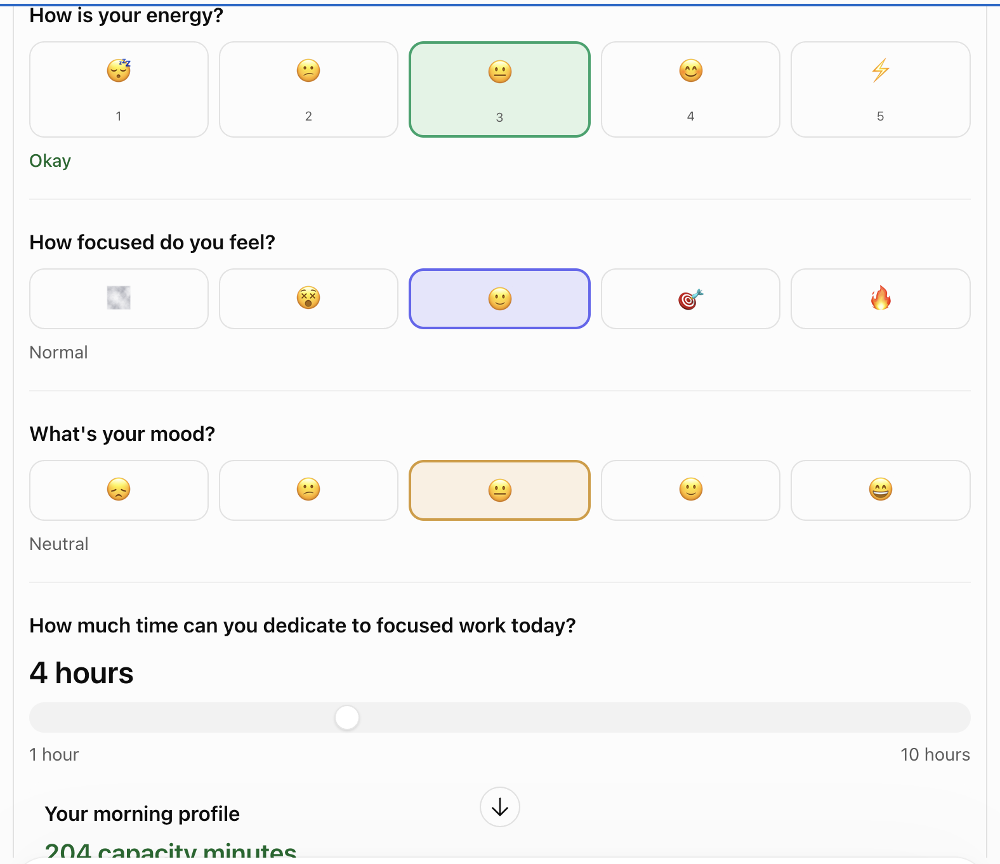

| Input | Control | Notes |
| --- | --- | --- |
| Energy | 1–5 scale, **battery icons** | Every option labeled (Drained … Vibrant) |
| Focus | 1–5 scale, **fog → target icons** | Every option labeled (Foggy … Clear) |
| Mood | **Categories**: Great · Calm · Neutral · Tired · Anxious · Low | **Optional**, can be skipped. Adjusts coach tone only (§9.2); not a capacity multiplier |
| Available focus time | Slider, 1–10 h | Fixed commitments / calendar sync deferred to Phase 4 |

**UI fixes compared with the current mockup** 🟡:

- Energy and mood currently use nearly identical faces. Keep faces for **mood only**.
- The first focus icon doesn't render (it shows a grey square).
- Label all five options, not only the selected one.
- Mood moves from a 1–5 scale to categories, because "anxious" and "sad" need different coaching.

Reference for categorical mood plus separate energy and focus sliders (external, inspiration only):

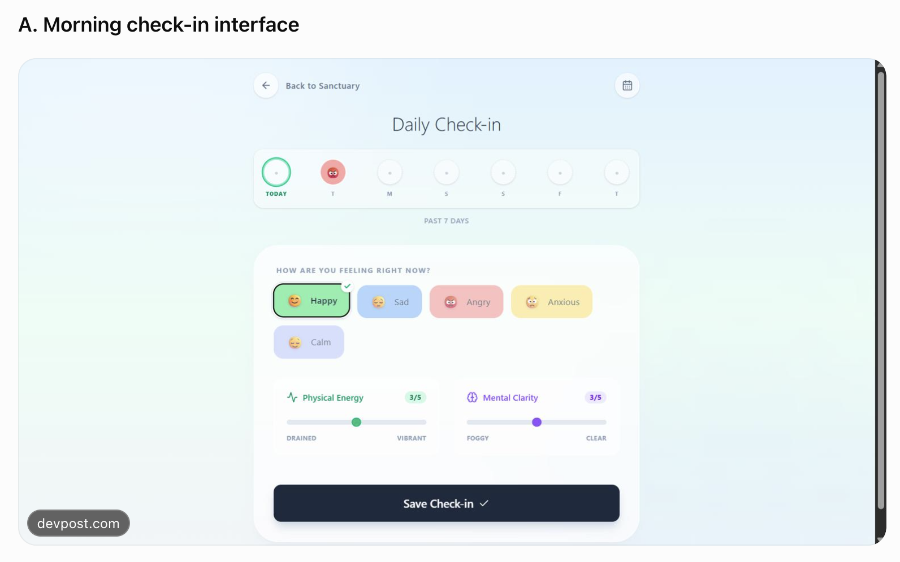

### 7.2 Capacity calculation ✅ (model) / 🟡 (fixes)

$$Capacity = \min(T,\; T \times E \times F)$$
$$Recommended = Capacity \times 0.8$$

| Rating | Energy (E) | Focus (F) |
| --- | --- | --- |
| 1 | 0.55 | 0.80 |
| 2 | 0.70 | 0.90 |
| 3 | 0.85 | 1.00 |
| 4 | 1.00 | 1.05 |
| 5 | 1.10 | 1.10 |

- `T` is available focus minutes.
- The `min()` cap matters: at 5/5 the product E × F is 1.21, which would otherwise promise more time than the user has.
- The 20 % buffer leaves room for interruptions.
- These multipliers are **product heuristics**, to be calibrated against real completion data.

**Worked example** (energy 3, focus 3, 4 h):

- Capacity = 240 × 0.85 × 1.0 = **204 min**
- Recommended = **163 min ≈ 2.7 h ≈ 6 focus sessions**

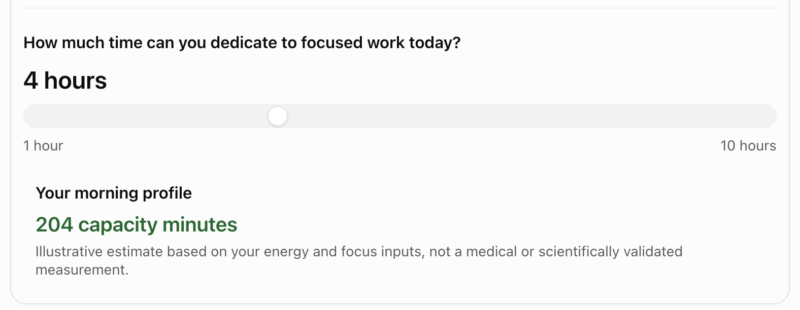

### 7.3 Capacity report

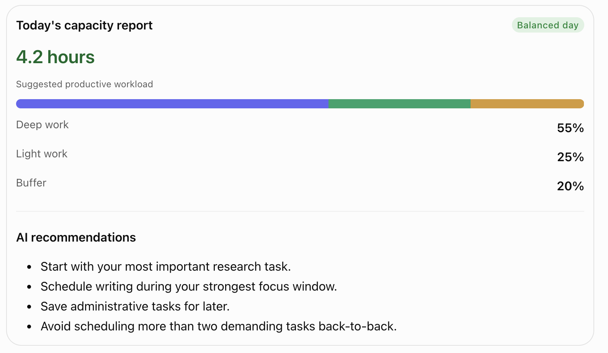

> ⚠️ This mockup says **4.2 hours**, which is more than the 4 h available. Using the example above it should read **2.7 h (~6 focus sessions)**. Show the result in focus sessions as well as minutes.

**Deep-work share depends on focus** 🟡, applied to the recommended workload:

| Focus rating | 1 | 2 | 3 | 4 | 5 |
| --- | --- | --- | --- | --- | --- |
| Deep work share | 40 % | 55 % | 70 % | 75 % | 80 % |

The rest is light work. The buffer is the 20 % already removed in §7.2.

**Account for every minute** ✅: the report and the check-in preview split the time the user gave into four parts that add up to it: deep work, light work, buffer, and **set aside**, which is the time removed by below-par energy or focus (available − capacity). Set-aside time is shown as a hatched segment and named with its reason, e.g. "36m of your 4h is set aside because your energy is Okay." It's left out when energy and focus don't reduce capacity.

**Overload warning:** if planned mission minutes exceed the recommended workload, the coach suggests what to move. It starts with Optional missions, then those that can move to tomorrow.

### 7.4 Dynamic capacity adjustment ✅

You can re-check in at any point in the day (for example, exhausted after lunch).

- Remaining capacity is recalculated from the remaining time and the new E and F values.
- The daily XP target is lowered to match, and never raised mid-day: new target = min(current target, XP already earned toward the target + the target for the remaining recommended minutes).
- Check-ins and daily plans are written by the server, which computes capacity and the target with the engine. Users can read them but not write or edit them, because the target unlocks the +20 bonus (principle 4).
- The coach offers to move Optional missions to tomorrow, framed as planning, not failure.
- Each check-in is stored as a **new snapshot**; earlier ones are never overwritten.

---

## 8. Focus mode & Boss Battles

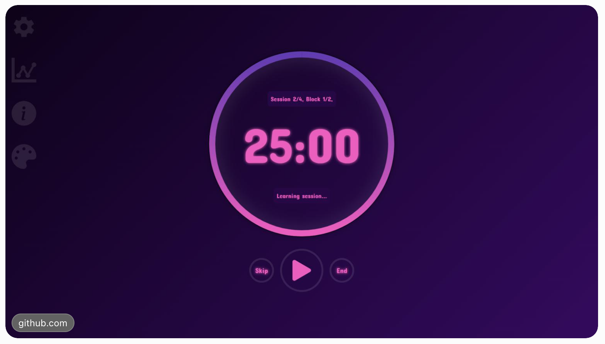

> External reference (github.com) used for mood only. In DAYQUEST the timer must show **which mission** it is for, the Boss health bar when relevant, and the XP on offer.

### 8.1 Timer ✅

- Presets **25/5** and **50/10**, or custom. Long break after 4 sessions.
- One-task interface: mission title, subtask, remaining time, controls only.
- Ambient sounds (rain, café, white noise). Additional sound packs are unlockable variants.
- Break reminders, with optional browser notifications.
- **Integrity:** the timer runs in the browser. The server records `started_at` and `ended_at`, and focus XP is granted only when that span covers the session length.
- **Interruptions:** pause is allowed (pause time is not counted). A session ended early earns partial XP if ≥ 50 % elapsed (§5.2).
- **Pauses are server-measured too:** pause and resume are recorded with the database clock, so a reload keeps the pause and the browser never reports its own focused time.
- **One session at a time:** only one open session per user, so sessions can't be stacked for XP. Starting another while one is running returns you to it.
- **Time's up is checked by the server:** when the browser's countdown ends, the server confirms the time with its own clock before ending the session. A fast device clock just lines the countdown back up, without ending the session early or costing XP.
- **Breaks:** 5 min after 25, 10 min after 50, and custom sessions get a fifth of their length (5–15 min). Every 4th completed session of the day earns a 15-min long break. Breaks are client-side and earn no XP.
- **v1 ambient sounds** are generated in the browser (white noise, rain), so no audio files are needed. Café and other packs need recorded audio and arrive as unlockable variants.

### 8.2 Boss Battles 🟡 (Phase 3)

A large mission becomes a **Boss**:

- The AI breaks it into subtasks, returned as structured JSON that the user confirms.
- The boss's health bar = 100 % × (remaining subtask weight / total weight).
- Each completed subtask reduces health; each earns normal task XP.
- Defeating the boss grants the **+50 milestone bonus** and a cosmetic reward.

---

## 9. AI coach

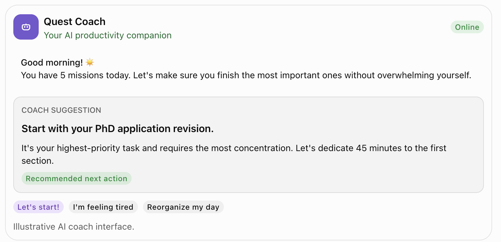

### 9.1 Responsibilities

| Time | Coach does |
| --- | --- |
| Morning | Reviews carried-over missions, compares the plan with capacity, suggests an order, breaks big tasks down |
| During the day | Recommends the next mission, offers a smaller first step ("I'm feeling tired"), re-plans ("Reorganize my day"), suggests breaks |
| Evening | Summarizes the day, proposes carry-over, drafts tomorrow's plan |
| Weekly | Writes the weekly growth report (§12) |

### 9.2 Rules ✅

- The coach **recommends**. Every change it proposes (reorder, move, split) needs the user to tap to accept, and is then applied by the normal task API.
- The coach has **no write access** to XP, levels or achievements.
- The coach speaks in **focus-session units** ("2 sessions on section 1"), not arbitrary minutes. The current mockup's "45 minutes" fits neither preset.
- The coach is **state-aware**: it never suggests a mission that's already done.
- **Tone follows the check-in mood:**

  | Mood | Coach tone |
  | --- | --- |
  | Great | Ambitious: suggests a stretch goal |
  | Calm | Normal coaching |
  | Neutral | Normal coaching |
  | Tired | Gentle: smaller first steps, more breaks |
  | Anxious | Grounding: one task at a time, short first session |
  | Low | Warm: lowest pressure, celebrates small wins |
  | *(skipped)* | Normal coaching |

- Every suggestion is logged in `ai_suggestions` with whether it was accepted, so we can measure whether the coach helps.

### 9.3 Implementation 🟡

- Rule-based scoring for "next mission" first (importance × difficulty × fit to remaining time). The LLM only explains the choice and handles free-form requests.
- Task breakdown uses the LLM with a strict JSON schema, validated before it's shown.
- Context sent to the LLM: today's missions, the check-in, recent completion stats. No more than needed.

### 9.4 Model choice ✅

**Claude Opus 5.5** (`claude-opus-5-5`) through the Anthropic TypeScript SDK (`@anthropic-ai/sdk`), with the effort setting tuned per feature:

| Coach feature | Effort |
| --- | --- |
| Quick nudges, "I'm feeling tired" replies, next-mission explanation | `low` |
| Morning plan, task breakdown, evening reflection, weekly report | `medium` |

- **Structured outputs** (a Zod schema with the SDK's parse helper) for task breakdowns and plan changes, so responses arrive already validated.
- **Prompt caching** on the fixed coach instructions and per-day context.
- **Estimated cost:** about 30k input and 5k output tokens per active day, at $4 / $20 per million tokens, comes to **≈ $0.20 per day (≈ $6 per month) per user** before caching. This is an estimate, not a measurement; log real token usage from Phase 3 on.
- **Cost lever for later:** try Claude Haiku 5.5 for the `low`-effort nudges once the coach is live, and compare quality before switching.

---

## 10. Companion system

### 10.1 Character ✅

**One original magical creature** with a consistent visual identity across all evolution stages and all themes.

The images below are **mood references only**. They come from different sources and art styles, they are not one character, and **they must not ship**. One appears to carry an AI-generator watermark; another resembles commercial game art.

| Stage 1–2 reference | Stage 3–4 reference |
| --- | --- |
| 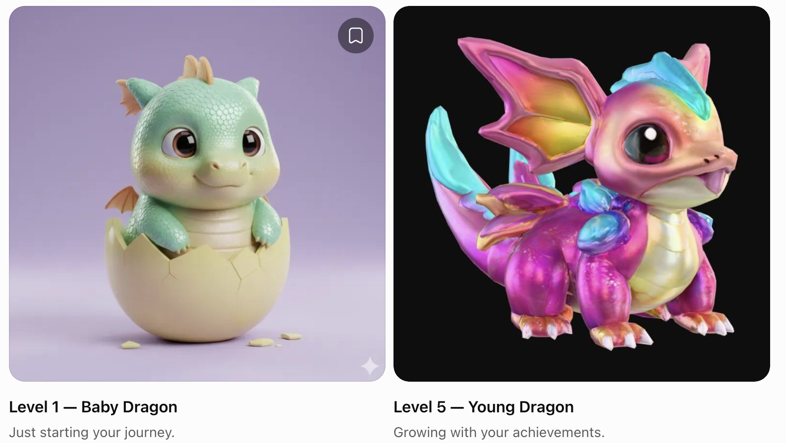 | 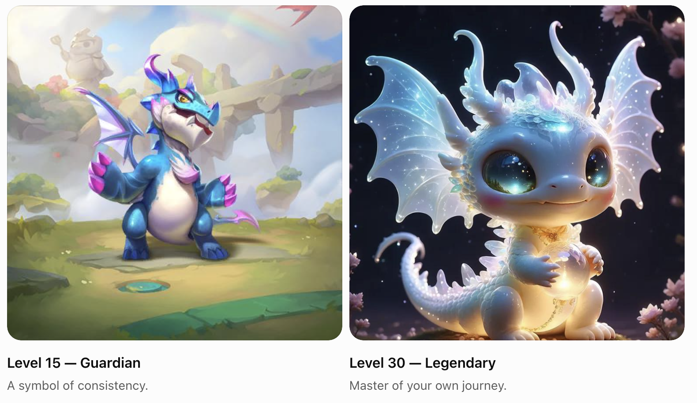 |

What to keep from the references: big expressive eyes, soft rounded body, an egg-hatch origin, wings and glow that grow with each stage.

**Species, name and personality** ✅

- **Species:** a small, original dragon that hatches from a **"day egg."** It stays generic enough not to resemble any existing character.
- **Name:** the user names their companion at hatching, which builds attachment from the first minute. The name can be changed later in Settings.
- **Personality:** warm, curious and a little sleepy. Never judgmental, always glad you came back.
- **Evolution reflects the user:**

  | Stage | Visual change |
  | --- | --- |
  | 1 · Hatchling | Peeks out of the day egg; tiny wing nubs |
  | 2 · Young | Grows real wings |
  | 3 · Guardian | Gains **markings colored by the user's most-practiced category** (Research, Wellness, …), so every Guardian looks a little different |
  | 4 · Legendary | Gains a soft glow and fully grown wings |

  The marking category is taken from focus minutes per category over the 30 days before the user reaches level 15. It's saved on the companion at that moment and stays fixed.

### 10.2 States 🟡

| State | Trigger | Animation |
| --- | --- | --- |
| `idle` | default | breathing, blinking |
| `happy` | mission completed | hop, smile |
| `excited` | level up / evolution | celebration (+ Lottie burst) |
| `focus` | focus session running | concentrated, quiet |
| `sleepy` | day not started yet, or low-energy check-in | yawn, curled up ("resting with you") |
| `thinking` | AI coach is planning | looking around |
| `welcome_back` | first open after ≥ 2 days away | delighted to see you |

There is **no sad, disappointed or angry state**. `welcome_back` replaces the earlier "sad on inactivity" idea.

```ts
type CompanionExpression =
  | "idle" | "happy" | "excited" | "focus"
  | "sleepy" | "thinking" | "welcome_back";
```

- The expression is **worked out on the frontend** from recent events and is not stored in the database.
- It is named `expression`, not `mood`, so it doesn't collide with the user's check-in mood.
- Level and evolution stage come from the XP total (§5.5), not from fields on the companion.

### 10.3 Asset pipeline ✅

| Asset | Technology |
| --- | --- |
| Main companion | **Rive** (state machine driven by `expression`, `stage`, theme color inputs) |
| Celebration effects | **Lottie** |
| Character portraits (achievements, sharing) | WebP |
| Icons | SVG |
| Background illustrations | WebP / SVG |

**Who makes the art:**

1. **AI-assisted concept exploration** of creatures, palettes, expressions and stages.
2. **A character artist or motion designer** refines one design, separates it into layers ready for rigging, draws vector art, builds the Rive rig and state machine, and exports a `.riv` file.
3. **Integration** through the Rive React runtime.

**Artist brief requirement** ✅: the creature must read clearly on a **light minimal** background (theme C, first), a **dark neon** background (theme A) and a **warm pastel** background (theme B). Use a clear outline, a balanced palette, and colors the app can change per theme through Rive inputs. Test early sketches on all three.

**Schedule risk:** art and rigging can take more than a month. Start concept work **during Phase 1** so Phase 2 isn't blocked.

---

## 11. Themes & visual design

### 11.1 Direction ✅

Three visual directions were explored:

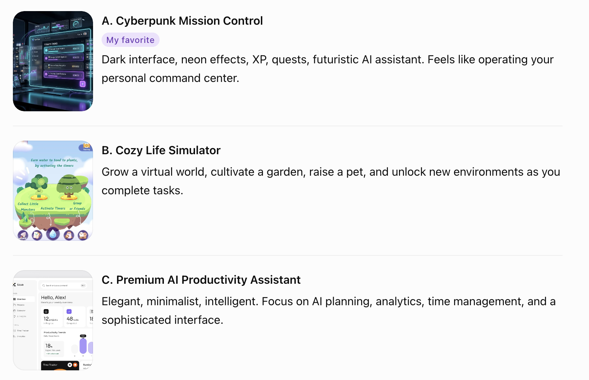

| Theme | Look | Build order |
| --- | --- | --- |
| **C · Minimal** | Light, clean, elegant, data-forward | **1st (v1)** |
| **A · Mission Control** | Dark, neon purple→pink, command center | 2nd |
| **B · Cozy** | Warm pastel, rounded, illustrated | 3rd |

- Users **choose a base theme at onboarding** and can change it anytime in Settings.
- The onboarding theme picker is **hidden until at least two themes exist**. v1 ships with Minimal only and skips that step.
- Once the picker exists, it shows a live preview (companion plus a sample mission card), not just color swatches.
- Theme B is a **look**. The "grow a garden / world" idea is a separate gameplay feature for later, not part of the theme.

Most current mockups (missions, coach, check-in, capacity) are already in the Minimal style, so v1 can build directly from them.

References for the later Mission Control theme (external, inspiration only):

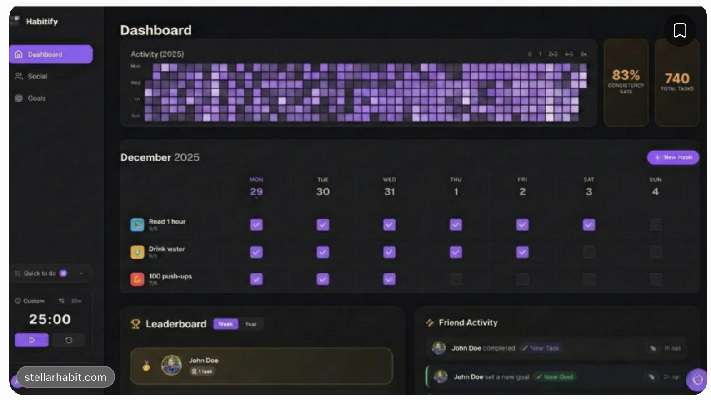

> Take the dark surfaces and purple accent from this reference. **Leave out** the leaderboard and friend feed, which go against principle 1. Replace the GitHub-style activity heatmap, whose empty squares read as failure, with forgiving metrics (§12).

### 11.2 Token architecture ✅

**Components never use raw colors.** Every color, radius, shadow, glow and font comes from a semantic CSS variable, and each theme supplies its own values for those variables. Tailwind utilities point at the variables (`bg-surface`, `text-accent`).

```css
:root[data-theme="minimal"] {
  --bg: #fafafa;  --surface: #ffffff;  --surface-2: #f3f3f5;
  --text: #1a1a1a;  --text-muted: #6b6b76;  --border: #e6e6ea;
  --accent: #5b5bd6;  --xp: #2f8f5b;  --warn: #c98a2b;
  --glow: none;  --radius: 14px;
  --font-body: "Inter";  --font-display: "Inter";
}
/* Later: [data-theme="mission"], [data-theme="cozy"] supply the same names. */
```

A **theme** is a bundle of:

- **Tokens:** color, radius, shadow and glow, typography.
- **Motion presets:** Framer Motion settings, such as soft bounces for Minimal and neon pulses for Mission Control.
- **Assets:** backgrounds, ambient sounds, Lottie color sets.
- **Chart palette:** must pass contrast checks on that theme's background.
- **Companion color inputs** for the Rive character.

Implementation notes:

- The chosen theme is saved to the **user's account** and mirrored in a cookie. The server sets `data-theme` on `<html>` while rendering, so the page never flashes the wrong theme.
- Each base theme has one mode in v1: Minimal is light, Mission Control dark, Cozy light. "Follow system" (pairing Minimal with Mission Control) comes later.
- **CI runs a contrast check (WCAG AA)** for every theme's text/background pairs, including small text like XP badges.

### 11.3 Unlockable variants ✅

Base themes are free choices. **Variants inside a theme** are level rewards:

| Variant type | Examples (Minimal) | Unlock |
| --- | --- | --- |
| Accent colors | Indigo (default), Sage, Ocean, Rose, Amber | Levels 3, 6, 9, 12 |
| Timer skins | Ring (default), Minimal bar, Flip clock, Hourglass | Levels 4, 8, 13 |
| Ambient sound packs | Rain (default), Café, Forest, Lo-fi | Levels 7, 11, 16 |
| Backgrounds | Plain (default), Paper, Soft gradient, Seasonal | Levels 10, 14, 18, seasonal events |
| Companion accessories | Scarf, glasses, tiny lantern | Achievements |

Rules:

- Accessibility settings, such as larger text, reduced motion or a high-contrast option, are **never locked**.
- Unlocks come from the XP total, so a reversed XP transaction that drops your level does not remove variants you've already unlocked.

---

## 12. Growth & analytics

Measure growth, not only task count:

| Metric | Shows |
| --- | --- |
| Completion rate | Share of planned missions finished |
| Focus hours | Measured, uninterrupted work |
| Deep-work sessions | Concentration consistency |
| Goal progress | Movement on Quests and Bosses |
| Energy patterns | When you work best (from check-in snapshots × completions) |
| Weekly consistency | **"Showed up 5 of 7 days"**, best week, return rate (forgiving, no broken streaks) |
| Capacity accuracy | Planned vs. completed minutes, to calibrate §7.2 |

**Weekly AI report:**

> *"This week you completed 82% of your planned missions. Your strongest area was research. You tend to finish hard tasks more often in the morning, so next week try scheduling demanding work before noon."*

The report's numbers are computed deterministically. The LLM only writes the prose around the computed figures.

---

## 13. Technical architecture

Original proposal:

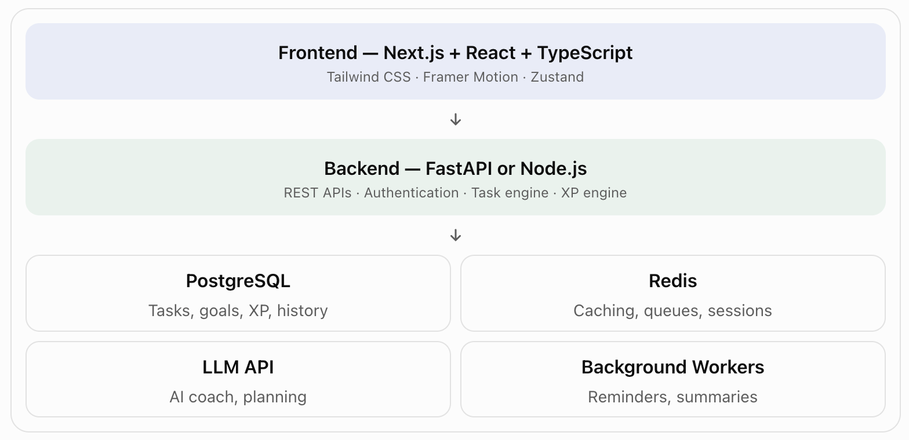

**Proposed v1** 🟡: a leaner version. One language, fewer moving parts.

| Layer | Choice | Notes |
| --- | --- | --- |
| Frontend + API | **Next.js (App Router) + React + TypeScript** | Server actions / route handlers hold the task, XP and capacity engines |
| Styling / motion / state | Tailwind (tokens via CSS vars) · Framer Motion · Zustand | |
| Database / auth | **PostgreSQL** (e.g., Supabase) | Row-level security per user |
| Scheduled jobs | Cron (platform cron or Supabase scheduled functions) | Day rollover, reminders, weekly report |
| AI | **Claude Opus 5.5** via `@anthropic-ai/sdk`, structured outputs | Coach, breakdown, weekly prose (§9.4) |
| Animation | Rive React runtime · lottie-react | |

Redis and dedicated background workers are **deferred** until a measured need appears.

**Users & auth** ✅: **multi-user-ready from day one, personal use first.**

- Sign-in from the start (e.g., Supabase Auth).
- Every table carries `user_id`, with row-level security turned on for all user data.
- This costs about a day now and avoids a painful retrofit later.
- Social features (leaderboards, friend feeds) stay out of scope, per principle 1.

**Engine placement:** the XP, leveling and capacity engines live in a framework-free TypeScript module (`/packages/engine` or `/src/engine`). They are pure functions with full unit tests, and the API calls them. The game economy can then be tested without the UI or the database.

---

## 14. Data model

Initial entities. Fields are indicative, not final.

| Table | Key fields | Notes |
| --- | --- | --- |
| `users` | id, timezone, day_rollover_hour (default 4), theme, theme_variants | |
| `tasks` | id, user_id, title, category, importance, difficulty, est_minutes, planned_date, status, parent_id, quest_id | `parent_id` → Boss subtasks |
| `quests` | id, user_id, title, is_boss, status | Projects and Boss Battles |
| `milestones` | id, quest_id, title, done_at | Source of the +50 bonus |
| `daily_checkins` | id, user_id, date, created_at, energy, focus, mood (nullable), available_min, capacity_min, recommended_min | **Many per day**: snapshots, never overwritten |
| `daily_plans` | id, user_id, date, checkin_id, xp_target, ordered_task_ids | Points to the check-in it was built from |
| `focus_sessions` | id, user_id, task_id (required), preset, planned_min, started_at, ended_at, paused_ms, outcome | Server timestamps validate XP |
| `xp_transactions` | id, user_id, amount, source_type, source_id, reason, day, created_at | **Unique (user_id, source_type, source_id, reason)**; reversals are negative rows on the same `day` as the award they cancel. Reasons are numbered streams: `task_completed#1`, `task_completed#1:reversal`, `task_completed#2`, `bonus:all_critical#1` |
| `reflections` | id, user_id, date, notes, carried_task_ids | Source of the +10 bonus |
| `achievements` | id, code, title, criteria | Static catalog |
| `user_achievements` | user_id, achievement_id, earned_at | |
| `user_unlocks` | user_id, unlock_code, unlocked_at | Theme variants and accessories |
| `companions` | user_id, name, hatched_at, marking_category, equipped_cosmetics | No level/XP/expression here, all derived. `marking_category` is set once at stage 3 |
| `ai_suggestions` | id, user_id, kind, payload, accepted, created_at | Measures coach usefulness |

Derived, never stored as truth: **level**, **evolution stage**, **companion expression**. A cached `user_levels` view may exist for speed, but it is rebuilt from `xp_transactions`.

---

## 15. Roadmap

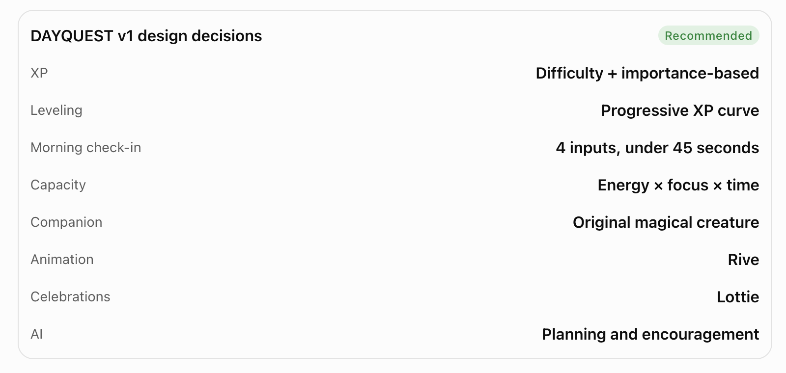

| Phase | Deliverables | In parallel |
| --- | --- | --- |
| **0 · Foundation** | Repo setup, token system + **Minimal theme**, engine package with tests | Companion concept exploration |
| **1 · Core engine** | Missions (today and tomorrow), check-in and capacity, focus timer linked to missions, XP and leveling, evening carry-over | Commission the character artist |
| **2 · Game experience** | Rive companion (all states), Lottie celebrations, achievements, unlockable variants | |
| **3 · Intelligence** | AI coach, task breakdown, Boss Battles, capacity-aware planning | |
| **4 · Personalization** | Growth dashboard, weekly report, calendar sync, **Mission Control theme** (theme picker appears), then Cozy | |

---

## Appendix: reference images

| File | What it is | Source |
| --- | --- | --- |
| `today-missions-mockup.png` | Today's missions card | Concept mockup (XP values outdated) |
| `ai-coach-mockup.png` | Quest Coach card | Concept mockup |
| `checkin-mockup.png` | 4-question check-in | Concept mockup |
| `capacity-minutes-mockup.png` | 204 capacity minutes | Concept mockup |
| `capacity-report-mockup.png` | Capacity report | Concept mockup (4.2 h figure wrong) |
| `daily-experience-flow.png` | Daily loop | Concept diagram |
| `app-structure.png` | Five areas | Concept diagram |
| `architecture.png` | Original stack proposal | Concept diagram |
| `visual-directions.png` | Directions A / B / C | Concept board (external thumbnails) |
| `v1-decisions.png` | v1 decision summary | Concept summary |
| `checkin-reference.png` | Categorical mood check-in | **External** (devpost.com), inspiration only |
| `focus-timer-reference.png` | Neon Pomodoro timer | **External** (github.com), inspiration only |
| `dashboard-reference.png` | Dark habit dashboard | **External** (stellarhabit.com), inspiration only |
| `companion-ref-stage-1-5.png` | Creature references | **External / AI-generated**, do not ship |
| `companion-ref-stage-15-30.png` | Creature references | **External / AI-generated**, do not ship |

> If this repository is public, consider removing the **external** images before publishing, or replacing them with links, since DAYQUEST doesn't own them.
